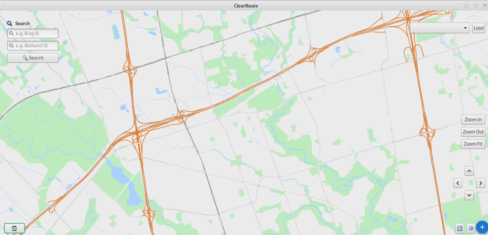
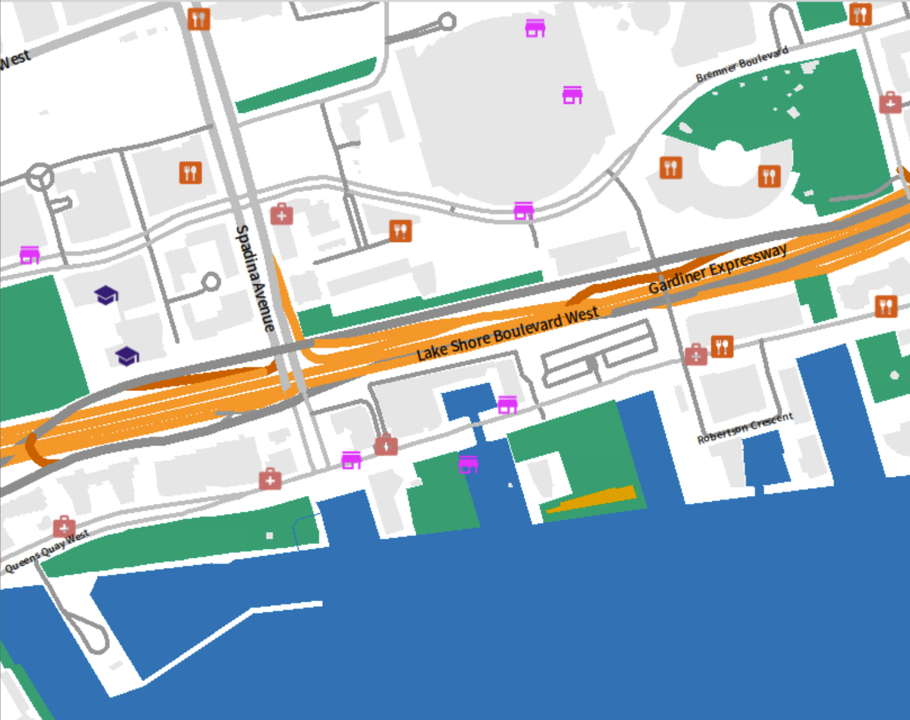
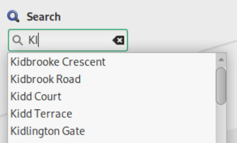
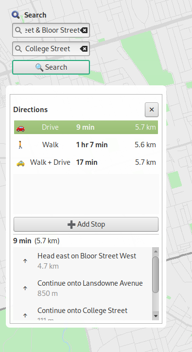

# ClearRoute
### Accessible navigation for people with low vision

  

**ECE297 · University of Toronto**

Built by **Laila Assy, Prithika Paraneetharan, and Daisy Grachev**.

ClearRoute is a mapping project built around a simple question: how can navigation be easier to use for people with low vision? We focused on readable maps, forgiving search, spoken directions, and a less cluttered interface.

## Features

### A clearer map
High-contrast map styling helps distinguish roads, water, buildings, and points of interest. Our design explores the Okabe–Ito palette and differences in brightness, rather than relying on colour alone.

### Search that handles imperfect input
Partial street names, abbreviation expansion, word-order-independent matching, and fuzzy matching help users find a destination without needing to type an exact name. Text-to-speech provides an audio channel for map labels and navigation instructions.

### One trip, multiple stops
Users can add, reorder, and remove stops in one workflow, with an organized overview and arrival cues along the route.

## How it works

- **Pathfinding:** Dijkstra’s algorithm and A* for finding routes through a road network.
- **Route optimization:** a greedy initial route followed by local improvements, including swaps, 2-opt, relocation, and double-bridge perturbations.
- **Parallel computation:** OpenMP splits repeated preprocessing work across threads.

## What we explored next

Our presentation also explores indoor navigation, streetlight information, and voice input. Incorporating lighting into route cost is a future direction; it is not presented here as a completed routing feature.

## About this repository

This repository is a visual overview of our ECE297 team project. The screenshots come from our final presentation. It contains project documentation rather than the course source code.

[Connect with Laila](https://www.linkedin.com/in/laila-assy/) · [Email](mailto:laila.assy@outlook.com)
